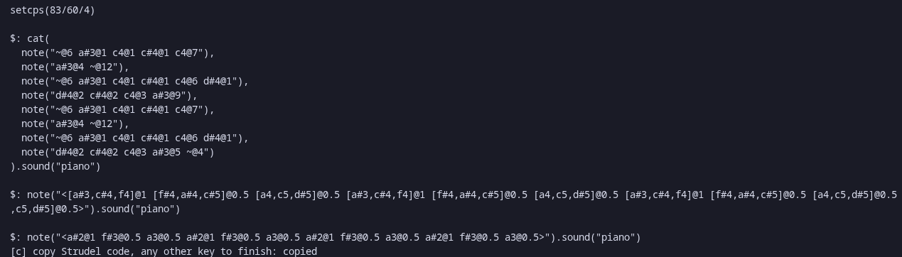
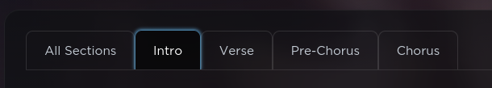
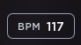
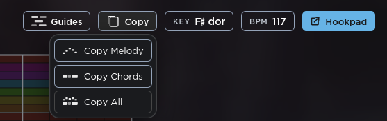

<div align="center">

# Strubot

Turn Hooktheory song JSON into Strudel code


[Features](#features) • [Install](#installation) • [Usage](#usage) • [Output](#output)



</div>

---

## Why Strubot
One time there was this ysws called aria and we had to make music in strudel i was searching ways to make cover songs and found hooktheory's json it was super detailed and then i thought ima just build a program that reads this and make strudel music and here we are...

## Features
- copy output
- input multiple json parts to get 1 song

## Installation

You can run Strubot from source with the .NET 10 SDK, or download a ready-to-run build from [Releases](https://github.com/Eraxty/Strubot/releases).

### Requirements

- .NET 10 SDK to run from source ([download](https://dotnet.microsoft.com/download/dotnet/10.0))
- A computer smh

Release builds include the .NET runtime, so you don't need to install .NET to use one.
Also please note that windows or mac builds havent been tested if they dont work make a pr fix it yourself or just build form source
### Run from source

```bash
git clone https://github.com/Eraxty/Strubot.git
cd Strubot
dotnet run
```

### Download a release

Download the file for your system from the [latest release](https://github.com/Eraxty/Strubot/releases/latest):

- `Strubot-linux-x64` for 64-bit Linux
- `Strubot-windows-x64.exe` for 64-bit Windows
- `Strubot-macos-x64` for Intel Macs smh who even uses this bruh
- `Strubot-macos-arm64` for Macs

On Linux or macOS make the downloaded file executable before running it:

```bash
chmod +x Strubot-linux-x64
./Strubot-linux-x64
```

For macOS, replace the filename above with the build for your Mac. On Windows, run `Strubot-windows-x64.exe`.

## Usage
1) go to [Hooktheory Tabs](https://www.hooktheory.com/theorytab) find the song you want to convert
2) You will see multiple parts of the song 
3) There are 4 parts in this song but other songs will differ
4) Check the bpm of the song 
5) 
6) In the Tabs section go to copy and the click "copy all" 
7) run the program
8) enter the bpm and the json part numbers and the jsons
9) get the output and press c to copy


## Output


## License
This project is licensed under the [MIT License](LICENSE).
